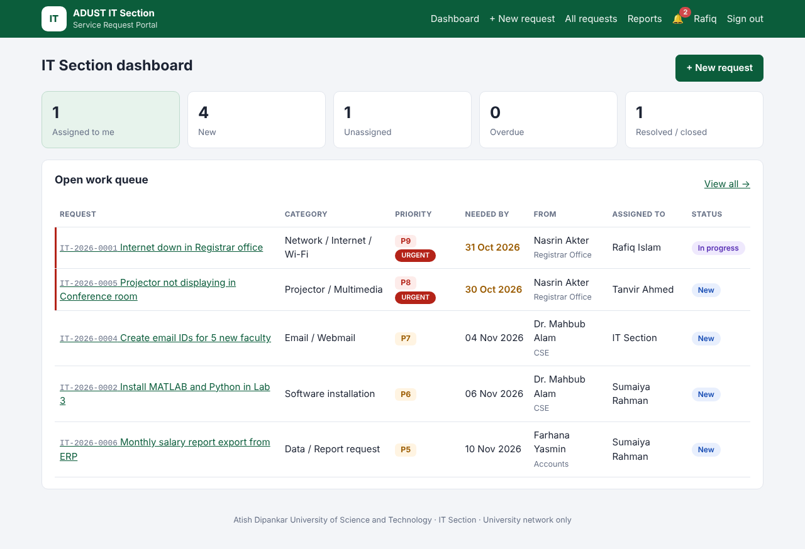

# ADUST IT Section — Service Request Portal

University staff send work to the **IT section** (e.g. hardware, network, software,
email). IT staff work on each request and post updates, and both sides are notified.
The portal only opens from the **university network**.



## Features

| | |
|---|---|
| **University network only** | Only allowed IPs/ranges can open the site; everyone else sees an "Access restricted" page. Managed in *Admin → Network* or via `PORTAL_ALLOWED_NETWORKS`. The server itself (localhost) always has access, and the admin cannot lock themselves out. |
| **Login** | Sign in with **university email or user ID** + password, or with the **@adust.edu.bd webmail password** (IMAP); first webmail login creates the account automatically. Self-registration only with a university email. |
| **Assign work to IT** | Title, **category**, **priority 1–10**, **urgent** flag, **needed-by date**, **which IT staff** it goes to (or the whole IT section), location, description, **remarks**, attachment. Each request gets a code like `IT-2026-0001`. |
| **IT workflow** | Work queue sorted by urgency → priority → deadline. Change status (New, In progress, On hold, Resolved, Closed, Rejected), reassign, change priority, reply to requester, attach files, and add **internal notes** the requester cannot see. |
| **Requester actions** | Track progress, add comments/files, cancel a new request, **confirm** a resolved one or **reopen** it. |
| **Notifications** | Bell with unread count (updates every 30 s) + desktop pop-up + **email**. IT is notified on new requests (assignee + IT admins, or the whole IT team if unassigned); the requester is notified on every IT update. |
| **Admin** | Users & roles (Requester / IT staff / IT admin), categories, allowed networks, reports (workload per IT staff, average resolve time, by category, by department). |

Lightweight: Python + Flask + SQLite, no JavaScript framework, a single CSS file.

## Quick start (try it)

```bash
pip install -r requirements.txt
flask --app app create-admin
flask --app app run --host 0.0.0.0
```

## Deploy on the university server (Ubuntu)

```bash
sudo apt install python3-venv nginx
sudo mkdir -p /opt/adust-it-portal /var/lib/adust-it-portal/uploads
sudo cp -r . /opt/adust-it-portal && cd /opt/adust-it-portal
sudo python3 -m venv venv && sudo venv/bin/pip install -r requirements.txt
sudo cp deploy/portal.env.example /etc/adust-it-portal.env   # then edit it
sudo chown -R www-data:www-data /var/lib/adust-it-portal
sudo -u www-data bash -c 'set -a; . /etc/adust-it-portal.env; venv/bin/flask --app app create-admin'
sudo cp deploy/adust-it-portal.service /etc/systemd/system/ && sudo systemctl enable --now adust-it-portal
sudo cp deploy/nginx.conf /etc/nginx/sites-available/adust-it-portal
sudo ln -s /etc/nginx/sites-available/adust-it-portal /etc/nginx/sites-enabled/ && sudo systemctl reload nginx
```

Then open the portal from a campus PC, sign in as admin and check **Admin → Network**: it shows
the IP the server sees for you. Add the campus ranges there.

**Backup:** copy `/var/lib/adust-it-portal/` (database + uploaded files).

### Useful commands

```bash
flask --app app create-admin                              # another IT admin
flask --app app allow-network 192.168.10.0/24 --label "Admin building"
```
