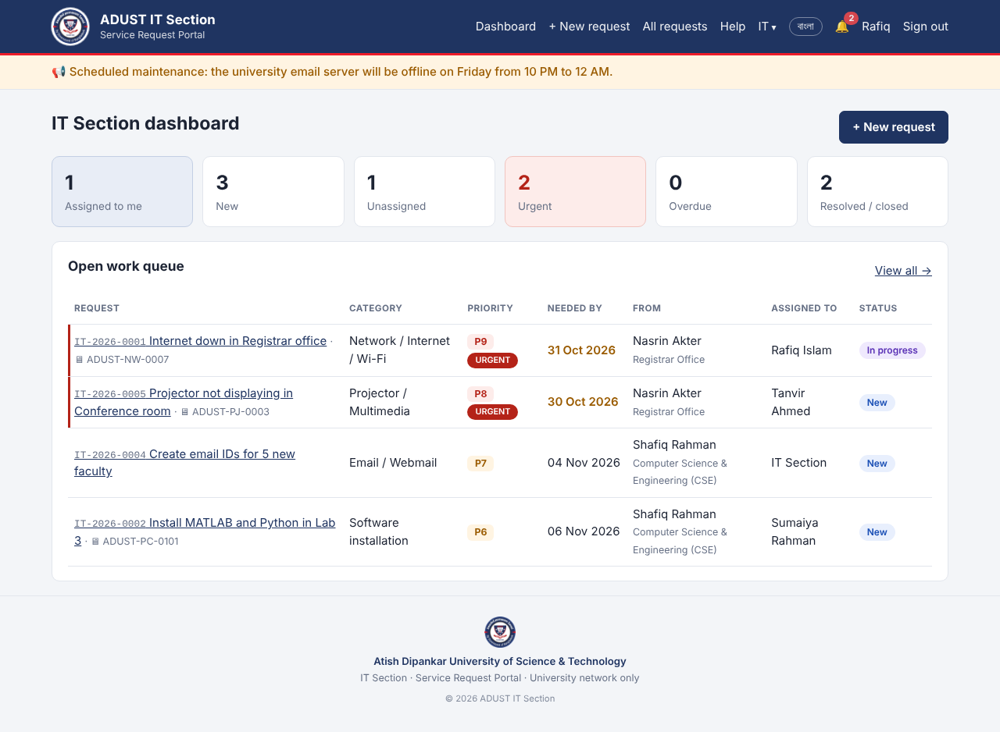

# ADUST IT Section — Service Request Portal

University staff send work to the **IT section**; IT staff work on each request and post
updates, and everyone is notified. The portal opens only from the **university network**,
works in **English and Bangla**, and runs on a single small server (Python + SQLite).



## Features

| Area | What it does |
|---|---|
| **University network only** | Only allowed IPs/ranges can open the site (ADUST: `172.20.0.0/16`, `172.16.0.0/24`); others see "Access restricted". Managed in *Admin → Network access*. Admin cannot lock themselves out. |
| **Sign-in** | **Any email** (institutional or personal, e.g. Gmail) **or** user ID + password. Anyone on the university network can register; set `PORTAL_ALLOWED_EMAIL_DOMAINS` to limit domains. **Forgot password** by email link (1 hour, single use). **Lock-out** after 5 wrong passwords (15 min). *Optional, off by default:* sign in with the university webmail password (IMAP). |
| **Assign work to IT** | Category, priority 1–10, urgent flag, needed-by date, which IT staff, location, **device (asset tag)**, description, remarks, attachment. Code like `IT-2026-0001`. Matching **help articles are suggested** while filling the form. |
| **Approvals (chairman → Registrar)** | Categories can need department approval and/or the Registrar's final approval. New purchases go: requester → department **Chairman** (or **Coordinator** if there is no chairman, or if the chairman is overdue) → **Registrar** → IT. Each decision is recorded with the approver's title, comment, uploaded **signature** and optional signed demand letter, and printed on the job card. |
| **IT workflow** | Queue sorted by urgency → priority → deadline. Status, reassign, priority, device, replies, attachments, **internal IT notes**. **Printable job card** with signature lines. |
| **Requester** | Track progress, comment, cancel, **confirm + rate (1–5 ★)** when done, or reopen. |
| **Notifications** | Bell + desktop pop-up + **email**; **SMS** to IT for urgent work and escalations. |
| **Reminders & escalation** | New request untouched for 4 h (1 h if urgent) → IT admins alerted. Overdue → daily alert. Pending approvals → reminder to the head. Resolved but not confirmed for 7 days → closed automatically. All times adjustable in *Settings*. |
| **Devices (asset inventory)** | Every PC/printer/projector/switch with tag, serial, location, warranty; full repair history; "consider replacing" hint; CSV import & Excel export. |
| **Recurring maintenance** | Daily / weekly / monthly / quarterly / yearly jobs become requests automatically. |
| **Help centre** | IT writes short how-to articles (headings, steps, links); searchable. |
| **Announcements** | Banner on every page, e.g. "Campus internet is down; we are working on it". |
| **Reports** | Any period: totals, avg. first response, avg. time to resolve, avg. rating, per IT staff, per category, per department, devices with most requests, last 12 months. **Excel** download and **Print / PDF**. Request lists also export to Excel. |
| **Backups** | Daily automatic zip of database + uploaded files (kept 14 days), plus "Create backup now" and download in *Admin → Backups*. |
| **Bangla / English** | Switch with one click in the header; remembered per user. |

Roles: **Requester** (staff/faculty), **IT staff**, **IT admin** (IT staff + manages the portal). Any user can also have an
**approval role**: Chairman, Head of office / Dean, Coordinator or Registrar.

**University structure** (from adust.edu.bd) is built in and grouped in every department list: Board of Trustees and
Vice-Chancellor, the offices of the Treasurer, Registrar (with its HR, Admission, Public Relation, Support Service,
Academic Affairs, IT, Design and Store sections), Controller of Examinations and Proctor, IQAC, ARIC, Library,
Transport, and the five faculties with their Dean's offices and 14 departments. Each department/office can have a
*parent office*: if nobody there has an approval role, approvals go to the parent (Store Section → Registrar,
Civil Engineering → Dean of FET). Admins can add, hide or regroup entries in *Admin → Departments*.

## Quick start (try it)

```bash
pip install -r requirements.txt
flask --app app create-admin
flask --app app run --host 0.0.0.0
```

## Run on a Windows PC (testing)

1. Install Python from python.org, then unzip the project (e.g. `G:\adust-it-portal`).
2. Open `windows\start-portal.ps1` in Notepad and check the settings at the top (data folder, backup copy, network).
3. Right-click `windows\allow-firewall.bat` → **Run as administrator** (once).
4. Double-click `windows\create-admin.bat` (once) to create the IT admin.
5. Double-click `windows\start-portal.bat` every time you want to run the portal.
6. New version: stop the portal, download the new ZIP to Downloads, double-click `windows\update-portal.bat`.

## Deploy on the university server

### Ubuntu / Debian server (recommended)

Copy the ZIP to the server, then:

```bash
unzip adust-it-portal-LIVE-*.zip && cd adust-it-portal
sudo bash deploy/install.sh
```

The script installs Python and nginx, copies the app to `/opt/adust-it-portal`, keeps data in
`/var/lib/adust-it-portal`, writes `/etc/adust-it-portal.env` with a random secret key, sets up the
systemd service and the nightly reminders/backup timer, configures nginx and asks for the first
IT admin. **To update later, unzip the new version and run the same command** — data and settings are kept.

Then edit `/etc/adust-it-portal.env` for email (SMTP), SMS and allowed networks, and run
`sudo systemctl restart adust-it-portal`.

### Windows server

Install Python, unzip to e.g. `D:\adust-it-portal`, check the settings at the top of
`windows\start-portal.ps1`, run `windows\allow-firewall.bat` as administrator and
`windows\create-admin.bat` once, then `windows\start-portal.bat`. It runs the portal with
**waitress** (a production server) and creates a random secret key on first start. Use Task
Scheduler ("At startup") to start `start-portal.bat` automatically.

Then, from a campus PC:

1. Sign in as admin → **Admin → Network access**: check the IP the server sees and add the campus ranges.
2. **Admin → Settings**: check the system status, send a test email / SMS.
3. **Admin → Users**: add IT staff; set approval roles (Chairman, Coordinator, Head of office / Dean, Registrar).
4. **Admin → Categories**: choose which categories need approval.
5. **IT → Devices**: import your device list (CSV template provided).

### Keeping the data safe (backup & restore)

All requests, users and history live in **one database file (`portal.db`)** plus the
**`uploads/`** folder. The portal never deletes requests, so the history stays forever
as long as these are safe. Follow the 3-2-1 rule:

| Copy | Where | Setting |
|---|---|---|
| Live data | Server's own local disk (not a network/Google Drive folder) | `PORTAL_DATABASE`, `PORTAL_UPLOADS` |
| Backup copy 1 | Same server, separate folder/disk (automatic daily zip) | `PORTAL_BACKUPS` |
| Backup copy 2 | **Another device**: NAS share, second disk, USB disk or a Google Drive/OneDrive synced folder | `PORTAL_BACKUP_COPY` |

- A backup is made every day; daily backups are kept *N* days (Settings) and **the first
  backup of every month is kept forever**, in both locations.
- *Admin → Backups* shows where everything is stored and warns if copy 2 fails.
- Once a month, also download the newest backup and store it offline (USB/external disk).
- Don't put the live `portal.db` inside Google Drive/OneDrive — syncing can corrupt it.
  Backup zips there are fine.

**Restore:** stop the portal, unzip a backup, copy `portal.db` and `uploads/` back to
their configured locations, start the portal.

### Useful commands

```bash
flask --app app create-admin                                   # another IT admin
flask --app app allow-network 192.168.10.0/24 --label "Admin building"
flask --app app housekeeping                                   # run reminders/backup now
flask --app app backup                                         # backup now
```

## Deploy on Vercel + Neon (cloud)

The same code runs on Vercel. When `DATABASE_URL` is set, it uses PostgreSQL (Neon) instead of SQLite. All tables live in their own schema (`adust_it`), so the portal can share the Neon `neondb` database with other apps. Uploaded files and signatures are stored in the database, because Vercel has no disk.

1. **GitHub**: push this folder to a private GitHub repository.
2. **Vercel** → *Add New → Project* → import the repository (framework: *Other*; nothing else to set).
3. **Environment Variables** (Project → Settings → Environment Variables):

   | Name | Value |
   |---|---|
   | `DATABASE_URL` | Neon connection string (the *pooled* one, `...-pooler...`). A `?schema=...` part is ignored. |
   | `PORTAL_SECRET_KEY` | a long random string (e.g. `python -c "import secrets;print(secrets.token_hex(32))"`) |
   | `PORTAL_SETUP_CODE` | a one-time code you choose, used to create the first IT admin at `/setup` |
   | `CRON_SECRET` | another random string (Vercel Cron sends it to `/cron/housekeeping` once a day) |
   | `PORTAL_ALLOWED_NETWORKS` | the university's **public** IP(s), e.g. `203.0.113.10/32`. Leave it empty until you know it. The campus 172.x addresses are private and are never seen by Vercel. |
   | `PORTAL_GITHUB_BACKUP_REPO` *(optional)* | `owner/repo` of a **private** repository for daily backups |
   | `PORTAL_GITHUB_TOKEN` *(optional)* | fine-grained token with *Contents: Read and write* on that repo only |
   | `SMTP_HOST`, `SMTP_PORT`, `SMTP_USER`, `SMTP_PASSWORD`, `SMTP_FROM` *(optional)* | email notifications |

4. **Deploy**, then open `https://<project>.vercel.app/setup`, enter the setup code, and create the first IT admin.
5. **Find the campus public IP**: on a campus PC, open <https://api.ipify.org>. Put that IP in `PORTAL_ALLOWED_NETWORKS` (with `/32`, or the whole block if the ISP gave one), then redeploy.

**Backups on Vercel:** Neon keeps its own point-in-time history. On top of that, the daily cron writes a full JSON backup zip to `backups/YYYY-MM/` in the GitHub backup repository, if one is configured. An IT admin can also download one at any time from *Admin → Backups*. To restore a backup into any database:
`DATABASE_URL=... flask --app app restore-backup backup.zip`

**Move data between servers:** `flask --app app export-backup x.zip` on the old server, then `restore-backup x.zip` on the new one. This works from SQLite to PostgreSQL and back.

## Project layout

```
app.py              routes, database, notifications, housekeeping, CLI
i18n.py             Bangla translations of all interface text
schema.sql          database tables
templates/          pages (help/, assets/, admin/ sub-folders)
static/             style.css, print.css, ADUST logo
deploy/             systemd units, nginx config, environment template
```
